<div align="center">


<br/>

[](https://github.com/justadudeinbulgaria/SWYF-OpenAI-GenAI-Mod/releases)
[](https://store.steampowered.com/app/3656290/Scam_With_Your_Friends/)
[](https://github.com/justadudeinbulgaria/SWYF-OpenAI-GenAI-Mod#supported-providers--configuration)
[](https://github.com/justadudeinbulgaria/SWYF-OpenAI-GenAI-Mod#in-game-screenshots)
[](LICENSE)

An open-source `Mono.Cecil` patcher (`SwyfModTool.exe`) and runtime AI/Voice bridge (`SurplusBridge.dll`) for *Scam With Your Friends*. It enables direct integration with the Google Gemini (GenAI) Standard API, OpenAI Standard API, OpenRouter, or any OpenAI-compatible endpoint for caller dialogue and cloud Speech-to-Text (STT), with separate Chat and Voice model configuration and an in-game settings panel.

[Releases](https://github.com/justadudeinbulgaria/SWYF-OpenAI-GenAI-Mod/releases) · [Installation](#installation) · [Screenshots](#in-game-screenshots) · [Configuration](#supported-providers--configuration) · [Issues](https://github.com/justadudeinbulgaria/SWYF-OpenAI-GenAI-Mod/issues)

</div>

---

## Overview

- **No Redistributed Game Binaries**: This repository does not contain proprietary game DLLs. `SwyfModTool.exe` patches your local installation's `Managed` assemblies in-place using `Mono.Cecil` and stores `.bak` backups of the original files.
- **Steam Update Detection**: When Steam updates *Scam With Your Friends* (including the October 18, 2026 update), running `SwyfModTool.exe` detects the unpatched game DLLs, refreshes the `.bak` backups, and reapplies the patches.
- **Local Key Storage**: API keys are stored locally in `ai_mod_config.json` and Unity `PlayerPrefs` and are only sent to the configured API endpoint.

---

## In-Game Screenshots

### 1. In-Game AI Mod Settings Panel (`Settings` -> `GENERAL`)
Configure the API token, toggle the local Whisper fallback, and set separate model IDs for caller dialogue (`CHAT AI MODEL ID`) and speech recognition (`VOICE AI MODEL ID`) from the settings menu:

<div align="center">
  
</div>

### 2. Whisper Offline Fallback Dropdown & Cloud STT Routing
Leaving **Whisper Offline Fallback** set to `Disabled (Saves ~400MB RAM)` prevents the game from loading the local `ggml` Whisper model (and skips the `Moonshine` CPU model) into memory when using cloud STT. It can be switched to `Enabled` if local offline fallback is needed:

<div align="center">
  
</div>

### 3. `AI MOD & HOST` Tab & Model Catalog
Browse, favorite, and select models returned by the configured provider's `/models` endpoint from the `AI MOD & HOST` tab in either the Main Menu or Pause Menu:

<div align="center">
  
</div>

### 4. Main Menu Status Indicator
Displays the current mod status on the Main Menu (`MOD INSTALLED: AI + VOICE READY`):

<div align="center">
  
</div>

---

## Features

| Feature | Description |
| :--- | :--- |
| **Multi-Provider API Support** | Supports Google Gemini (GenAI Standard API) (`gemini-2.5-flash`, `gemini-2.5-pro`, `gemini-3.8-flash`), OpenAI Standard API (`gpt-4o-mini`, `gpt-4o`, `gpt-4o-mini-transcribe`, `whisper-1`), OpenRouter, and custom OpenAI-compatible endpoints. |
| **Separate Chat & Voice Model IDs** | Configure `model` (caller dialogue) and `voice_model` (Speech-to-Text transcription) independently in-game or via `ai_mod_config.json`. |
| **Local Whisper & Moonshine Bypass** | Skips loading the ~400MB local Whisper `ggml` model and disables the `Moonshine` CPU recognizer when `enable_whisper_fallback` is `false` (default), reducing memory usage. |
| **Background Audio Processing** | Runs PCM16 WAV encoding, `0.008f` RMS silence trimming, Base64 encoding, and JSON parsing on background threads (`Task.Run`), and reuses completed or in-flight partial transcripts on utterance finalization. |
| **Single-Word Transcript Fix** | Patches `SpeechTranscriptPostprocessor.IsUnwantedOneWordTranscript` in `MetaVosk.dll` so single-word responses (`"Yes"`, `"No"`, `"Hello"`, `"Done"`) are not filtered out. |
| **Phone Status HUD** | Shows current voice/AI stage and response times on the in-game phone banner (`LISTENING TO YOUR VOICE...`, `LIVE TRANSCRIBING SPEECH...`, `WAITING FOR CALLER AI...`, `YOUR MIC IS LIVE [STT: 0.42s \| AI: 1.15s]`). |
| **Extended Context Window** | Increases the conversation history limits from `10k` tokens / `128` turns to `900k` tokens / `4096` turns (`max_tokens: 4096`). |
| **Telemetry & Disk Log Removal** | Disables `AnalyticsCollector`, `AnalyticsCollection`, and main-thread `KolkataApi.LogOpenRouterPayload` disk logging. |

---

## Architecture

```mermaid
flowchart LR
    A["16kHz Mic Stream\n(WhisperVcPipeline)"] -->|"0.65s Partial / 0.55s Final\n0.008f RMS Silence Trim"| B["SurplusBridge.TranscribeAsync\n(Partial Transcript Reuse)"]
    B -->|"gemini_native / whisper_api\nchat_audio / local fallback"| C["Voice AI Model (STT)\n(voice_model)"]
    C -->|"Transcript\n(0.99 Confidence)"| D["CallerAiPipeline\n(900k Token Context)"]
    D -->|"gameplay_caller_turn\nJSON Schema + Auto-Repair"| E["Chat AI Model (Dialogue)\n(model)"]
    E -->|"Structured Caller Response\n+ Latency Timers"| F["Phone HUD\n& Caller Voice Synthesis"]
```

<div align="center">
  
</div>



---

## Installation

1. Close **Scam With Your Friends** if it is running.
2. Download the latest archive from [**Releases**](https://github.com/justadudeinbulgaria/SWYF-OpenAI-GenAI-Mod/releases) (or run `dist\SwyfModTool.exe` from this repository).
3. `SwyfModTool.exe` scans drives `A:`–`Z:` to locate your `Scam With Your Friends` Steam directory.
4. Select **`[1] Install / Update Mod & Configure API`**, choose a provider (**Google Gemini GenAI**, **OpenAI**, **OpenRouter**, or **Custom**), enter your API key, and press **ENTER**.
5. The patcher will:
   - Back up the original game DLLs (`*.bak`),
   - Patch `ScriptsAssDef.dll`, `Assembly-CSharp.dll`, `MetaVosk.dll`, and `com.whisper.unity.dll` via `Mono.Cecil` and verify the resulting IL,
   - Write `ai_mod_config.json` in the game folder,
   - Run an API connectivity check for chat and voice transcription.
6. Start the game. Settings can be adjusted at any time under **Settings -> `GENERAL`**.

---

## Supported Providers & Configuration

Settings can be modified in-game (`Settings` -> `GENERAL`) or by editing `ai_mod_config.json` in the game root directory. Environment variables (`SWYF_API_KEY`, `GEMINI_API_KEY`, `GOOGLE_API_KEY`, `OPENAI_API_KEY`) are also supported.

### Option A: Google Gemini (GenAI Standard API)
API keys can be created in [Google AI Studio](https://aistudio.google.com/apikey):
```json
{
  "provider": "gemini",
  "api_key": "YOUR_GEMINI_API_KEY",
  "fallback_api_key": "",
  "endpoint": "https://generativelanguage.googleapis.com/v1beta/openai/chat/completions",
  "models_endpoint": "https://generativelanguage.googleapis.com/v1beta/openai/models",
  "stt_endpoint": "https://generativelanguage.googleapis.com/v1beta/models/{model}:generateContent",
  "stt_mode": "gemini_native",
  "model": "gemini-2.5-flash",
  "voice_model": "gemini-2.5-flash",
  "enable_whisper_fallback": false
}
```

### Option B: OpenAI Standard API
API keys can be created in the [OpenAI Platform](https://platform.openai.com/api-keys):
```json
{
  "provider": "openai",
  "api_key": "YOUR_OPENAI_API_KEY",
  "fallback_api_key": "",
  "endpoint": "https://api.openai.com/v1/chat/completions",
  "models_endpoint": "https://api.openai.com/v1/models",
  "stt_endpoint": "https://api.openai.com/v1/audio/transcriptions",
  "stt_mode": "whisper_api",
  "model": "gpt-4o-mini",
  "voice_model": "gpt-4o-mini-transcribe",
  "enable_whisper_fallback": false
}
```

### Option C: OpenRouter / Custom OpenAI-Compatible Endpoint
```json
{
  "provider": "custom",
  "api_key": "YOUR_API_KEY",
  "fallback_api_key": "",
  "endpoint": "https://openrouter.ai/api/v1/chat/completions",
  "models_endpoint": "https://openrouter.ai/api/v1/models",
  "stt_endpoint": "https://openrouter.ai/api/v1/chat/completions",
  "stt_mode": "chat_audio",
  "model": "google/gemini-2.5-flash",
  "voice_model": "google/gemini-2.5-flash",
  "enable_whisper_fallback": false
}
```

### `stt_mode` Options
| `stt_mode` | Description |
| :--- | :--- |
| `"gemini_native"` | Google GenAI `v1beta/models/{model}:generateContent` using `inline_data` (`audio/wav`). |
| `"whisper_api"` | OpenAI `/v1/audio/transcriptions` (`multipart/form-data` WAV upload, e.g., `gpt-4o-mini-transcribe` or `whisper-1`). |
| `"chat_audio"` | OpenAI-compatible `/v1/chat/completions` using `input_audio` (`format: "wav"`). |
| `"local"` | Uses the built-in local Whisper model for Speech-to-Text while routing caller dialogue to the configured cloud API. |

---

## Command-Line Interface

`SwyfModTool.exe` supports non-interactive CLI arguments:

```powershell
# Install & configure with Google Gemini Standard API
SwyfModTool.exe --install --provider gemini --api-key "YOUR_KEY" --model "gemini-2.5-flash" --voice-model "gemini-2.5-flash" --no-pause

# Install & configure with OpenAI Standard API
SwyfModTool.exe --install --provider openai --api-key "YOUR_KEY" --model "gpt-4o-mini" --voice-model "gpt-4o-mini-transcribe" --no-pause

# Run API verification test only
SwyfModTool.exe --test --no-pause

# Uninstall mod & restore original .bak files
SwyfModTool.exe --restore --no-pause
```

---

## Building from Source

### Requirements
- [.NET SDK 8.0+](https://dotnet.microsoft.com/download) (targets `.NET Framework 4.8` for Unity Mono compatibility)
- Local installation of *Scam With Your Friends*

### Build Commands
```powershell
# 1. Build SurplusBridge.dll against the game's Managed directory
dotnet build src/SurplusBridge/SurplusBridge.csproj -c Release -p:GameManagedDir="C:\Program Files (x86)\Steam\steamapps\common\Scam With Your Friends\Scam With Your Friends_Data\Managed"

# 2. Build SwyfModTool.exe
dotnet build src/SwyfModTool/SwyfModTool.csproj -c Release
```

---

## Repository Structure

```text
SWYF-OpenAI-GenAI-Mod/
├── assets/
│   ├── banner.png                          # Repository banner
│   ├── architecture.png                    # Runtime pipeline diagram
│   └── screenshots/                        # In-game UI & settings screenshots
├── dist/
│   ├── SwyfModTool.exe                     # Prebuilt installer, patcher & API tester
│   ├── SurplusBridge.dll                   # Prebuilt runtime AI/Voice/UI bridge
│   ├── Mono.Cecil*.dll                     # IL weaver dependencies
│   └── ai_mod_config.example.json          # Example configuration file
├── src/
│   ├── SurplusBridge/
│   │   ├── SurplusBridge.cs                # Runtime STT, Chat AI, UI injection & HUD bridge
│   │   └── SurplusBridge.csproj
│   └── SwyfModTool/
│       ├── Program.cs                      # Mono.Cecil patcher, IL verifier & API tester
│       └── SwyfModTool.csproj
├── CHANGELOG.md
├── CONTRIBUTING.md
├── LICENSE
└── README.md
```

---

## License

Released under the [MIT License](LICENSE).
