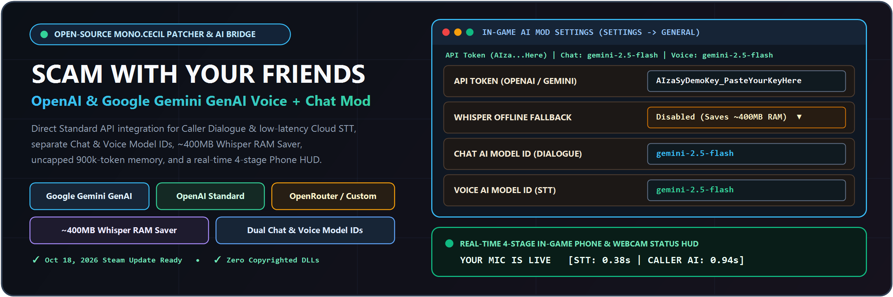
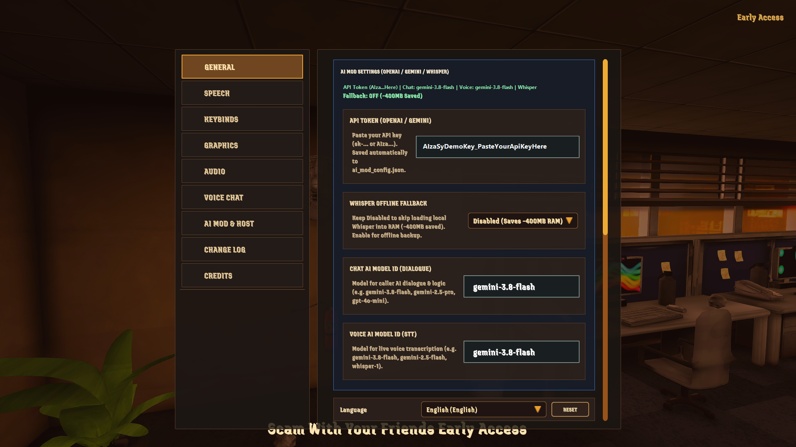
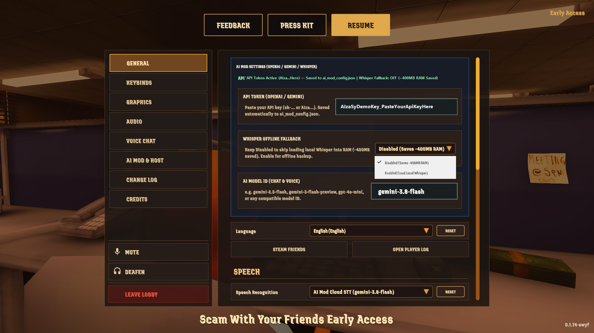
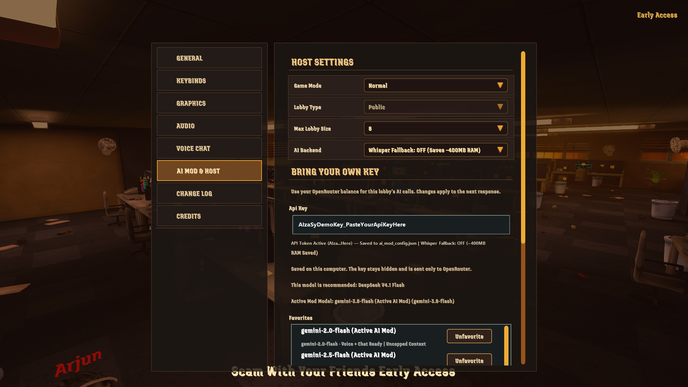
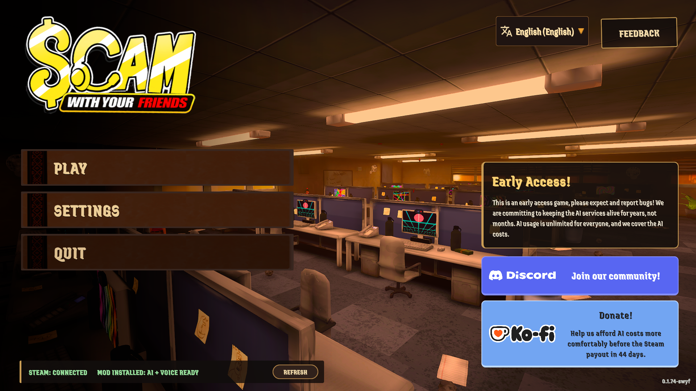
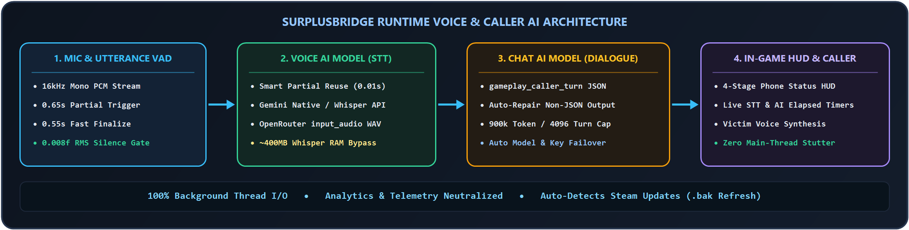

<div align="center">



<br/>

[](https://github.com/justadudeinbulgaria/SWYF-OpenAI-GenAI-Mod/releases)
[](https://store.steampowered.com/app/3656290/Scam_With_Your_Friends/)
[](https://github.com/justadudeinbulgaria/SWYF-OpenAI-GenAI-Mod#-supported-providers--configuration)
[](https://github.com/justadudeinbulgaria/SWYF-OpenAI-GenAI-Mod#-in-game-mod-settings--400mb-ram-saver)
[](LICENSE)

**An open-source `Mono.Cecil` patcher (`SwyfModTool.exe`) and runtime AI/Voice bridge (`SurplusBridge.dll`) for *Scam With Your Friends* that unlocks direct integration with the Google Gemini (GenAI) Standard API, OpenAI Standard API, OpenRouter, or any OpenAI-compatible gateway — featuring ultra-low-latency Cloud Speech-to-Text, separate Chat & Voice Model IDs, a ~400MB Whisper RAM Saver, and a real-time 4-stage HUD overlay.**

[Download Latest Release](https://github.com/justadudeinbulgaria/SWYF-OpenAI-GenAI-Mod/releases) · [Quick Start](#-1-click-quick-start) · [In-Game Screenshots](#-in-game-screenshots) · [Configuration](#-supported-providers--configuration) · [Report a Bug](https://github.com/justadudeinbulgaria/SWYF-OpenAI-GenAI-Mod/issues)

</div>

---

## 🛡️ 100% Clean, Safe & Open Source

- **Zero Copyrighted Game Binaries**: This repository distributes **zero** proprietary game DLLs. `SwyfModTool.exe` patches your local Steam installation's `Managed` assemblies in-place using `Mono.Cecil` and automatically maintains `.bak` backups.
- **Auto-Detects Steam Game Updates**: When Steam updates *Scam With Your Friends* (including the **October 18, 2026** update with `Moonshine` & `Deepgram` speech branches), re-running `SwyfModTool.exe` automatically detects the fresh unpatched game DLLs, refreshes your `.bak` backups, and applies all patches cleanly.
- **Zero Hardcoded Keys**: Your API keys stay strictly on your machine (`ai_mod_config.json` / Unity `PlayerPrefs`).

---

## 📸 In-Game Screenshots

### 1. In-Game AI Mod Settings Panel (`Settings` $\rightarrow$ `GENERAL`)
Configure your **API Token**, toggle **Whisper Offline Fallback (`~400MB RAM Saver`)**, and set separate **Chat AI Model ID (Dialogue)** and **Voice AI Model ID (STT)** directly inside the game menu without restarting:

<div align="center">
  
</div>

### 2. Whisper Offline Fallback Dropdown (`~400MB RAM Saver`) & Cloud STT Routing
Keep **Whisper Offline Fallback** set to `Disabled (Saves ~400MB RAM)` when using Cloud STT so the game skips loading the local `ggml` Whisper model (and skips the `Moonshine` CPU model) into memory, or switch it to `Enabled` for offline backup:

<div align="center">
  
</div>

### 3. Unlocked `AI MOD & HOST` Tab & Model Catalog
Browse, favorite, and switch models from your configured provider's `/models` endpoint directly from the **`AI MOD & HOST`** tab in both the Main Menu and In-Game Pause Menu:

<div align="center">
  
</div>

### 4. Main Menu Mod Status Verification Badge
Confirm at a glance on the Main Menu that the mod and voice pipeline are active (`MOD INSTALLED: AI + VOICE READY`):

<div align="center">
  
</div>

---

## ✨ Key Features

| Feature | Description |
| :--- | :--- |
| **🌐 Direct Multi-Provider Support** | Works natively with **Google Gemini (GenAI Standard API)** (`gemini-2.5-flash`, `gemini-2.5-pro`, `gemini-3.8-flash`), **OpenAI Standard API** (`gpt-4o-mini`, `gpt-4o`, `gpt-4o-mini-transcribe`, `whisper-1`), **OpenRouter**, or any custom OpenAI-compatible endpoint. |
| **🎛️ Dual Chat & Voice Model IDs** | Customize your **Chat AI Model ID (`model`)** for caller dialogue/reasoning and your **Voice AI Model ID (`voice_model`)** for Speech-to-Text transcription independently — either in-game or via `ai_mod_config.json`. |
| **💾 ~400MB Whisper & Moonshine RAM Saver** | Skips loading the ~400MB local Whisper `ggml` model and disables the `Moonshine` CPU model when `enable_whisper_fallback` is `false` (default), cutting memory usage and startup hitching. |
| **⚡ Ultra-Low-Latency Voice Pipeline** | Offloads PCM16 WAV encoding, `0.008f` RMS silence trimming, Base64 encoding, and JSON parsing to background threads (`Task.Run`). Reuses completed or in-flight live partial transcripts in `0.01s` when you stop speaking. |
| **🗣️ Single-Word Answer Fix** | Patches `SpeechTranscriptPostprocessor.IsUnwantedOneWordTranscript` in `MetaVosk.dll` so short answers like `"Yes"`, `"No"`, `"Hello"`, or `"Done"` are never discarded. |
| **📟 4-Stage Real-Time Phone HUD** | Displays live stage & latency telemetry on the in-game Phone & Webcam banner:<br/>• `LISTENING TO YOUR VOICE...`<br/>• `LIVE TRANSCRIBING SPEECH... (0.8s)`<br/>• `TRANSCRIBING VOICE TO CALLER... (0.4s)`<br/>• `WAITING FOR CALLER AI... (1.1s) [STT: 0.42s]`<br/>• `YOUR MIC IS LIVE [STT: 0.42s \| AI: 1.15s]` |
| **🧠 Uncapped Conversation Memory** | Removes the vanilla `10k` token / `120KB` / `128`-turn context compaction limits (raised to `900k` tokens / `4096` turns / `4096` max output tokens) so callers never forget earlier parts of a long scam call. |
| **🔒 Zero Telemetry & Zero Disk Spam** | Neutralizes all 43 methods in `AnalyticsCollector` & `AnalyticsCollection` and disables main-thread `KolkataApi.LogOpenRouterPayload` disk writes. |

---

## 🏗️ Architecture & Voice/AI Pipeline

```mermaid
flowchart LR
    A["🎙️ 16kHz Mic Stream\n(WhisperVcPipeline)"] -->|"0.65s Partial / 0.55s Final\n0.008f RMS Silence Trim"| B["⚡ SurplusBridge.TranscribeAsync\n(Smart Partial Reuse)"]
    B -->|"gemini_native / whisper_api\nchat_audio / local fallback"| C["🗣️ Voice AI Model (STT)\n(voice_model)"]
    C -->|"Clean Transcript\n(0.99 Confidence)"| D["🧠 CallerAiPipeline\n(Uncapped 900k Context)"]
    D -->|"gameplay_caller_turn\nJSON Schema + Auto-Repair"| E["🤖 Chat AI Model (Dialogue)\n(model)"]
    E -->|"Structured Caller Response\n+ Live Latency Telemetry"| F["📟 4-Stage Phone HUD\n& Caller Voice Synthesis"]
```

<div align="center">
  
</div>



---

## 🚀 1-Click Quick Start

1. Close **Scam With Your Friends** if it is running.
2. Download the latest release from [**Releases**](https://github.com/justadudeinbulgaria/SWYF-OpenAI-GenAI-Mod/releases) (or run **`dist\SwyfModTool.exe`** from this repository).
3. `SwyfModTool.exe` automatically scans drives `A:`–`Z:` to locate your `Scam With Your Friends` Steam installation.
4. Select **`[1] Install / Update Mod & Configure API`**, pick your provider (**Google Gemini GenAI**, **OpenAI**, **OpenRouter**, or **Custom**), paste your API key, and press **ENTER**.
5. `SwyfModTool` will:
   - Create `.bak` backups of your unpatched game DLLs,
   - Patch `ScriptsAssDef.dll`, `Assembly-CSharp.dll`, `MetaVosk.dll`, and `com.whisper.unity.dll` via `Mono.Cecil` and verify every IL instruction body,
   - Save `ai_mod_config.json` in your game root,
   - Run a **Live Chat + Voice STT Verification Test** against your API endpoint.
6. Launch the game! You can change your **API Token**, **Whisper Offline Fallback**, **Chat AI Model ID**, and **Voice AI Model ID** anytime inside **Settings $\rightarrow$ `GENERAL`**.

---

## ⚙️ Supported Providers & Configuration

You can edit settings **live in-game** (`Settings` $\rightarrow$ `GENERAL`) or via `ai_mod_config.json` in your game folder (environment variables `SWYF_API_KEY`, `GEMINI_API_KEY`, `GOOGLE_API_KEY`, and `OPENAI_API_KEY` are also supported).

### Option A: Google Gemini (GenAI Standard API)
Get an API key from [Google AI Studio](https://aistudio.google.com/apikey):
```json
{
  "provider": "gemini",
  "api_key": "YOUR_GEMINI_API_KEY",
  "fallback_api_key": "",
  "endpoint": "https://generativelanguage.googleapis.com/v1beta/openai/chat/completions",
  "models_endpoint": "https://generativelanguage.googleapis.com/v1beta/openai/models",
  "stt_endpoint": "https://generativelanguage.googleapis.com/v1beta/models/{model}:generateContent",
  "stt_mode": "gemini_native",
  "model": "gemini-2.5-flash",
  "voice_model": "gemini-2.5-flash",
  "enable_whisper_fallback": false
}
```

### Option B: OpenAI Standard API
Get an API key from [OpenAI Platform](https://platform.openai.com/api-keys):
```json
{
  "provider": "openai",
  "api_key": "YOUR_OPENAI_API_KEY",
  "fallback_api_key": "",
  "endpoint": "https://api.openai.com/v1/chat/completions",
  "models_endpoint": "https://api.openai.com/v1/models",
  "stt_endpoint": "https://api.openai.com/v1/audio/transcriptions",
  "stt_mode": "whisper_api",
  "model": "gpt-4o-mini",
  "voice_model": "gpt-4o-mini-transcribe",
  "enable_whisper_fallback": false
}
```

### Option C: OpenRouter / Custom OpenAI-Compatible Multimodal Gateway
```json
{
  "provider": "custom",
  "api_key": "YOUR_API_KEY",
  "fallback_api_key": "",
  "endpoint": "https://openrouter.ai/api/v1/chat/completions",
  "models_endpoint": "https://openrouter.ai/api/v1/models",
  "stt_endpoint": "https://openrouter.ai/api/v1/chat/completions",
  "stt_mode": "chat_audio",
  "model": "google/gemini-2.5-flash",
  "voice_model": "google/gemini-2.5-flash",
  "enable_whisper_fallback": false
}
```

### Supported `stt_mode` Values
| `stt_mode` | Description |
| :--- | :--- |
| `"gemini_native"` | Google GenAI Standard `v1beta/models/{model}:generateContent` with `inline_data` (`audio/wav`). |
| `"whisper_api"` | OpenAI Standard `/v1/audio/transcriptions` (`multipart/form-data` WAV upload — e.g. `gpt-4o-mini-transcribe` or `whisper-1`). |
| `"chat_audio"` | OpenAI-compatible `/v1/chat/completions` with `input_audio` (`format: "wav"`). Automatically selected when changing `voice_model` to a multimodal chat model on OpenRouter/Custom gateways, or automatically switched to `whisper_api` if `voice_model` contains `whisper` or `transcribe`. |
| `"local"` | Uses the game's built-in offline local Whisper CPU model for Speech-to-Text while routing caller AI dialogue to your cloud API. |

---

## 💻 Command-Line Interface (CLI) Automation

`SwyfModTool.exe` supports non-interactive CLI flags for scripts and mod managers:

```powershell
# Install & configure with Google Gemini Standard API
SwyfModTool.exe --install --provider gemini --api-key "YOUR_KEY" --model "gemini-2.5-flash" --voice-model "gemini-2.5-flash" --no-pause

# Install & configure with OpenAI Standard API
SwyfModTool.exe --install --provider openai --api-key "YOUR_KEY" --model "gpt-4o-mini" --voice-model "gpt-4o-mini-transcribe" --no-pause

# Run live Chat + Voice STT verification test only
SwyfModTool.exe --test --no-pause

# Uninstall mod & restore original unpatched .bak game files
SwyfModTool.exe --restore --no-pause
```

---

## 🛠️ Building from Source

### Prerequisites
- [.NET SDK 8.0+](https://dotnet.microsoft.com/download) (builds target `.NET Framework 4.8` for Unity Mono compatibility)
- Local installation of *Scam With Your Friends* on Steam

### Build Commands
```powershell
# 1. Build SurplusBridge.dll against your game's Managed folder
dotnet build src/SurplusBridge/SurplusBridge.csproj -c Release -p:GameManagedDir="C:\Program Files (x86)\Steam\steamapps\common\Scam With Your Friends\Scam With Your Friends_Data\Managed"

# 2. Build SwyfModTool.exe
dotnet build src/SwyfModTool/SwyfModTool.csproj -c Release
```

---

## 📂 Repository Structure

```text
SWYF-OpenAI-GenAI-Mod/
├── assets/
│   ├── banner.svg                          # Vector hero banner
│   ├── architecture.svg                    # Runtime pipeline diagram
│   └── screenshots/                        # In-game UI & settings screenshots
├── dist/
│   ├── SwyfModTool.exe                     # Prebuilt interactive installer, patcher & tester
│   ├── SurplusBridge.dll                   # Prebuilt runtime AI/Voice/UI bridge
│   ├── Mono.Cecil*.dll                     # IL weaver dependencies
│   └── ai_mod_config.example.json          # Example configuration template
├── src/
│   ├── SurplusBridge/
│   │   ├── SurplusBridge.cs                # Runtime STT, Chat AI, UI injection & HUD bridge
│   │   └── SurplusBridge.csproj
│   └── SwyfModTool/
│       ├── Program.cs                      # Mono.Cecil patcher, IL verifier & live API tester
│       └── SwyfModTool.csproj
├── CHANGELOG.md
├── CONTRIBUTING.md
├── LICENSE
└── README.md
```

---

## 📜 License

Released under the [MIT License](LICENSE).
